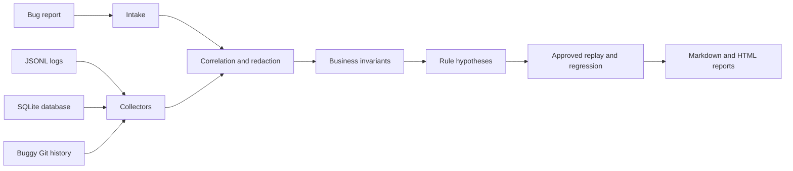

# BugTrace Lite

BugTrace Lite is a fixed investigation pipeline for the gap between a reported defect and a verified regression test. It collects request evidence from JSONL logs, SQLite and the relevant Git history, checks the evidence against quote and credit rules, and writes a report engineers can inspect.

The sample system is a small FastAPI quotation service with SQLite storage. The investigation path is rule based and works offline. The optional LLM adapter is not included in this version. No customer telemetry or external service is required.

## Quick start

Python 3.11 is the supported baseline. From a clean checkout:

```text
git clone https://github.com/DEM0NISH/bugs.git
cd bugs
python -m venv .venv
```

Activate the environment with `.venv\Scripts\Activate.ps1` in Windows PowerShell or `source .venv/bin/activate` on macOS and Linux. Then run:

```text
python -m pip install -r requirements.txt
python -m bugtrace build-demo
python -m bugtrace investigate BT-01 --approve
python -m bugtrace evaluate
```

The demo builder creates synthetic repositories and runtime data under `.workspace/`. Reports are written under `reports/`. The evaluator compares six synthetic cases with the evaluator-only ground truth files.

## Example report excerpt

The generated `reports/BT-01.md` includes an evidence timeline, invariant results and ranked hypotheses. The evaluator run recorded the request total as `64900.00`, while the two-line 5 percent discount example expects `61655.00`.

```text
Verdict: defect_indicated
pricing_math: FAIL, logged line inputs or pricing stages do not match the specification
stored_pricing_math: FAIL, stored quote columns do not agree with line items and the specification
```

## Architecture



## Synthetic cases

| Case | Scenario | Expected evaluation |
| --- | --- | --- |
| BT-01 | Supplier discount omitted for a multi-line quote | Defect indicated |
| BT-02 | GST rounded per line | Defect indicated |
| BT-03 | Retrying an idempotency key creates another quote | Defect indicated |
| BT-04 | Cancelling a confirmed quote leaves credit reserved | Defect indicated |
| NC-01 | Reporter expects a discount the supplier agreement does not grant | No defect found |
| NC-02 | Reported request ID is absent from available evidence | Insufficient evidence |

The baseline quote-service tests cover validation, ordinary pricing, stored values, credit limits, cancellation races, and flushed JSONL logs. Each seeded defect is designed to remain green under that baseline suite. The generated regression test checks the triggering path on the buggy and corrected Git references.

The evaluation table below is copied from `reports/evaluation.md` after running the evaluator. Sample size: 6 synthetic cases; passed: 6/6.

| Case | Expected verdict | Actual verdict | Result |
| --- | --- | --- | --- |
| BT-01 | defect_indicated | defect_indicated | PASS |
| BT-02 | defect_indicated | defect_indicated | PASS |
| BT-03 | defect_indicated | defect_indicated | PASS |
| BT-04 | defect_indicated | defect_indicated | PASS |
| NC-01 | no_defect_found | no_defect_found | PASS |
| NC-02 | insufficient_evidence | insufficient_evidence | PASS |

## Data handling

SQL collection opens the SQLite database in read-only mode and runs parameterized `SELECT` queries stored under `sql/`. Evidence is redacted before it is stored in an investigation model or written into a report. Git collection is restricted to an allowlist of quote-service files and inspects only the buggy reference. The evaluator alone reads `ground_truth/`.

Generated regression tests are deterministic templates. Their imports are checked against an allowlist before execution. Reproduction and regression commands use temporary Git worktrees and remove them when finished. An LLM integration is not implemented; reports state that offline rule mode was used.

## Limitations

The quote service and six cases are synthetic. The invariant rules are hand-written and cover a small pricing, idempotency and credit-ledger surface. There is no real observability integration. The regression test is templated. The optional LLM adapter is not implemented. The project does not use Docker. The local verification environment has Python 3.12.14; CI is configured for Python 3.11, but that CI job has not run from this workspace.

## Roadmap

Possible follow-up integrations include Jira, Jenkins, OpenTelemetry, a VS Code extension and mutation testing.

## Screenshots

Place screenshots in `docs/screenshots/` and link to them from the relevant documentation.

## Development note

This project was built with AI coding assistance. Its behavior is checked by the quote-service test suite and the evaluation harness. The evaluation output should be regenerated after code changes.
